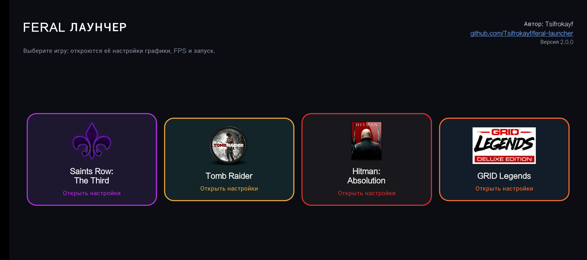
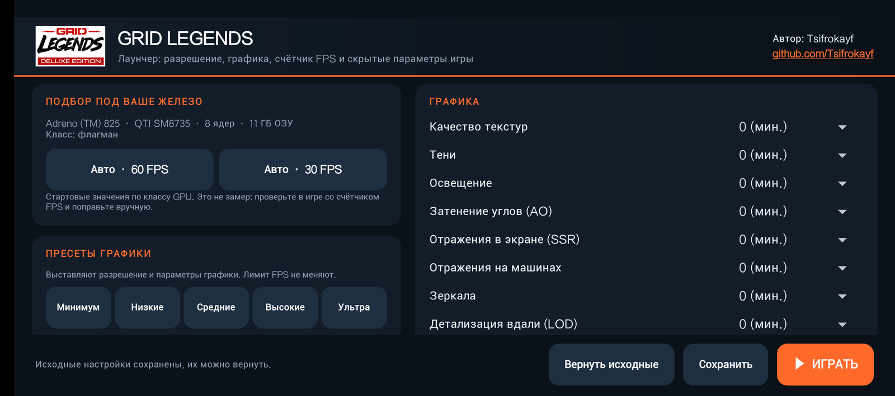
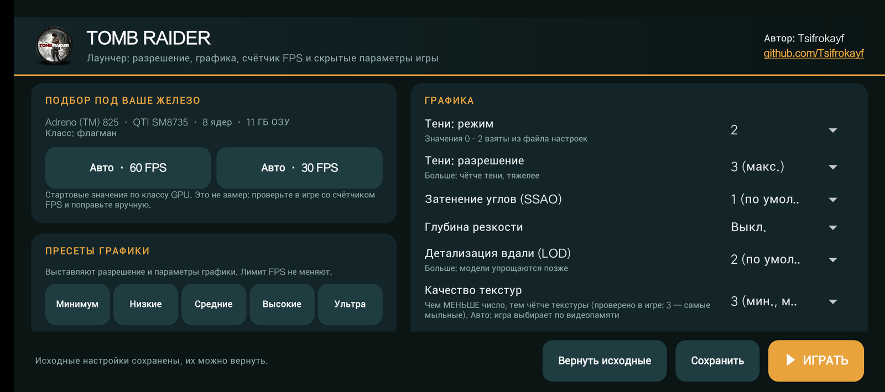

<h1 align="center">Feral Лаунчер</h1>

<p align="center">
  Один лаунчер настроек для Android-портов Feral Interactive:<br>
  <b>Saints Row: The Third</b>, <b>Tomb Raider</b>, <b>Hitman: Absolution</b>, <b>GRID Legends</b>.
</p>

<p align="center">
  
</p>

> **English:** Feral Launcher is a single Android app with a settings screen for each of four Feral Interactive ports:
> *Saints Row: The Third*, *Tomb Raider*, *Hitman: Absolution* and *GRID Legends*. It edits each game's preferences file
> through [Shizuku](https://shizuku.rikka.app/) or root: render resolution, per-option graphics quality, FPS limit,
> hidden engine options and one-tap presets. It does not modify the game APKs.

## Зачем это нужно

В портах почти нет настроек: картинка получается мутной, а выбрать тени, отражения, сглаживание или лимит кадров нельзя.
Все эти значения лежат в файле настроек игры. Лаунчер читает и аккуратно правит именно этот файл, а потом запускает игру.

## Как устроен лаунчер

На главном экране четыре карточки. Установленные игры подсвечены, неустановленные серые. Нажмите на игру: откроются её настройки в её цветах,
кнопка «Назад» возвращает к выбору. Настройки и резервные копии у игр раздельные. В углу главного экрана автор, ссылка на репозиторий и версия.

<p align="center">
  
  
</p>

## Возможности

- **Подбор под ваше железо.** «Авто · 60 FPS» и «Авто · 30 FPS» определяют класс GPU (Adreno, Mali, Immortalis, Xclipse; запасной вариант по ОЗУ и числу ядер) и выставляют стартовый набор настроек.
- **Пресеты графики:** «Минимум», «Низкие», «Средние», «Высокие», «Ультра». Лимит FPS пресеты не меняют.
- **Графика по отдельности:** тени, освещение, затенение углов, отражения, сглаживание, детализация вдали, трава, частицы, качество текстур и другое. Набор свой у каждой игры.
- **Разрешение и частота кадров:** разрешение рендера, динамическое разрешение, лимит 30 / 40 / 60 / 90 / 120 FPS (то, что поддерживает экран).
- **Скрытые параметры движка,** которых нет в меню игры: многопоточный рендер и очередь кадров, параметры Vulkan, менеджер частоты кадров, тонкая настройка динамического разрешения, управление гироскопом и другое.
- **Счётчик FPS в игре** (Saints Row): выключен, компактный или полный.
- **Производительность (нужен root):** привязка потоков игры к ядрам, приоритет, размер подкачки zram и swappiness с откатом.
- **Резервная копия.** При первом сохранении создаётся копия исходного файла настроек, кнопка «Вернуть исходные» её восстанавливает.
- **Root или Shizuku.** Работает через root (Magisk, KernelSU, APatch) или Shizuku. Если Shizuku установлен, в карточке «Первичная настройка» есть кнопка «Открыть Shizuku», а если нет, то «Скачать Shizuku». Доступ можно выдать командой ADB, её можно скопировать одной кнопкой.
- **Обновления.** При запуске лаунчер проверяет GitHub Releases. Если вышла новая версия, на главном экране появляется баннер с кнопками «Позже» и «Обновить»; при обновлении показывается полоса загрузки, потом открывается установщик Android.

## Требования

- Android 11 или новее.
- Установленная игра: Saints Row: The Third (`com.feralinteractive.saintsrow3_android`), Tomb Raider (`com.feralinteractive.tombraider_android`),
  Hitman: Absolution (`com.feralinteractive.hitmanabsolution_android`) или GRID Legends (`com.feralinteractive.gridlegends_android`).
- Доступ к папке игры: **root** или [Shizuku](https://shizuku.rikka.app/), запущенный и с выданным разрешением. Android 11+ не даёт обычным приложениям писать в `Android/data` другого приложения.
- Игру нужно запустить хотя бы один раз до главного меню: при этом создаётся файл настроек.

## Первая настройка

### 1. Доступ к файлам игры

**Есть root:** откройте любую игру в лаунчере и нажмите «Проверить» в карточке «Первичная настройка», разрешите root в Magisk/KernelSU/APatch. Shizuku не нужен.

**Root нет, нужен Shizuku:**

1. Установите Shizuku (кнопка в лаунчере, Google Play или [страница релизов](https://github.com/RikkaApps/Shizuku/releases)).
2. Включите режим разработчика: **Настройки → О телефоне → Номер сборки**, нажмите 7 раз.
3. **Настройки → Для разработчиков → Беспроводная отладка**: включите (нужен Wi‑Fi).
4. В Shizuku выберите «Запуск через беспроводную отладку» → «Сопряжение», введите код из настроек.
5. Нажмите «Запустить». Вверху должно появиться «Shizuku работает».
6. Откройте лаунчер и разрешите ему доступ к Shizuku. Если окно не появилось, выдайте доступ командой ADB, которую лаунчер показывает в карточке «Первичная настройка» (кнопка «Скопировать»).

> Без root Shizuku нужно запускать заново после каждой перезагрузки телефона.
> Если доступа нет, строка статуса внизу мигает красным, а при запуске показывается баннер с гайдом.

### 2. Запустите игру один раз

Дождитесь главного меню игры и закройте её. Так создаётся файл настроек, который правит лаунчер.

### 3. Установите лаунчер и выберите настройки

1. Скачайте `Feral_Launcher_*.apk` со страницы [Releases](../../releases) и установите.
2. Выберите игру на главном экране. В строке состояния внизу должно быть «Настройки загружены».
3. Нажмите «Авто · 60 FPS» / «Авто · 30 FPS» или выберите пресет.
4. Нажмите «▶ ИГРАТЬ»: лаунчер сохранит настройки, перезапустит игру и откроет её. Кнопка «Сохранить» только записывает настройки.

Меняйте по одному параметру и проверяйте результат в одной и той же сцене.

| Что вы видите | Что менять |
|---|---|
| FPS ниже цели, упор в GPU | Снизить разрешение, затем тени, затенение углов, отражения |
| FPS ниже цели, GPU не загружен | Упор в CPU: уменьшить сцену (персонажи, транспорт, зрители), оставить включённым многопоточный рендер |
| Картинка мутная | Выше разрешение, качественнее сглаживание, текстуры |
| Скачки разрешения | В тонкой настройке динамического разрешения увеличьте задержку повышения или поднимите минимальный масштаб |

## Особенности игр

- **Tomb Raider:** шкала «Качество текстур» перевёрнута: чем меньше число, тем чётче текстуры (0 самые чёткие, 3 самые мыльные). Лимит FPS меняется только если вы тронули его в лаунчере: настройка FPS в самой игре сохраняется.
- **Hitman: Absolution:** игра сама сбрасывает значения вне своих пределов (SSAO не выше 2, разрешение текстур не выше 1, MSAA сбрасывается в 0), поэтому лаунчер предлагает только допустимые. Пропуск заставок при запуске не работает: ключ есть, но эта версия игры его не использует.
- **GRID Legends:** значения настроек взяты из файла игры; пункт «Асинхронные вычисления» помечен как опасный: при включении игра может зависнуть на заставке.
- **Saints Row: The Third:** включённая «Файловая память игры» (`UseFileBackedMemory`) вызывала вылеты на некоторых планшетах.

## Что нужно знать

- После смены разрешения или графики игра заново прогревает шейдеры: в первые минуты возможны подлаги.
- После принудительной остановки игра может показать окно про «аварийную остановку». Это не сбой: выберите «Не отправлять».
- «Вернуть исходные» возвращает файл настроек, который был до первого сохранения из лаунчера.
- Если игра обновится или настройки сбросятся, откройте лаунчер заново: он перечитывает файл при запуске.

## Как это работает

Игра читает настройки из `Android/data/<пакет игры>/files/feral_app_support/preferences` (XML в стиле реестра) при каждом запуске.
Лаунчер читает этот файл через `Shizuku.newProcess` или `su -c`, меняет нужные значения точечными заменами (форматирование не трогается),
записывает файл обратно и запускает игру. APK игры не изменяется.

## Известные ограничения

- Часть скрытых параметров основана на названиях ключей в файле и в движке: как именно каждый влияет на картинку и FPS, проверено не для всех.
- Лаунчер меняет настройки игры, но не добавляет в неё сторонние апскейлеры или генерацию кадров (FSR, GSR, lsfg-vk и подобные).
- Игра может молча заменить значение, которое счёл недопустимым, если оно выходит за её пределы.

## Переход со старых лаунчеров

Feral Лаунчер заменяет отдельные приложения
[sr3-launcher](https://github.com/Tsifrokayf/sr3-launcher),
[tomb-raider-launcher](https://github.com/Tsifrokayf/tomb-raider-launcher) и
[hitman-launcher](https://github.com/Tsifrokayf/hitman-launcher).
SR3 Лаунчер обновится на Feral Лаунчер поверх (тот же пакет и подпись). Лаунчеры Tomb Raider и Hitman имеют другие пакеты: установите Feral Лаунчер и удалите их вручную.

## Сборка из исходников

Нужны JDK 17, Android SDK (платформа 34) и Gradle 8.x.

```bash
echo "sdk.dir=/путь/к/Android/sdk" > local.properties
gradle assembleRelease
# APK: app/build/outputs/apk/release/app-release.apk
```

Для своей подписи положите `launcher.jks` рядом с папкой `app` и задайте переменную `KS_PASS`; иначе релиз подписывается отладочным ключом.

## Отказ от ответственности

Проект неофициальный и никак не связан с Feral Interactive и другими правообладателями. Названия и логотипы игр принадлежат их владельцам
и используются только для обозначения игр, с которыми работает лаунчер. Лаунчер не содержит и не распространяет файлы игр: нужна собственная копия.
Вы меняете настройки на свой риск; перед правкой лаунчер делает резервную копию файла настроек.

## Автор

**Tsifrokayf**, [github.com/Tsifrokayf](https://github.com/Tsifrokayf)

## Лицензия

Код распространяется по лицензии MIT, см. [LICENSE](LICENSE). Лицензия не распространяется на логотипы и товарные знаки.
